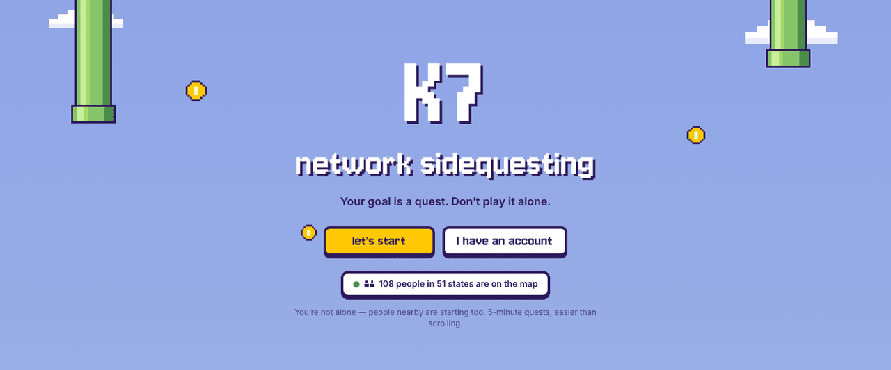
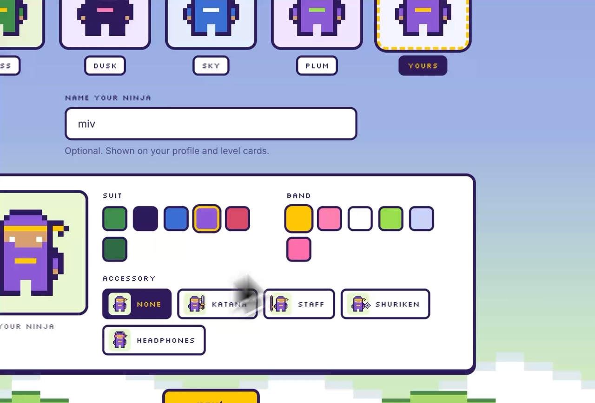
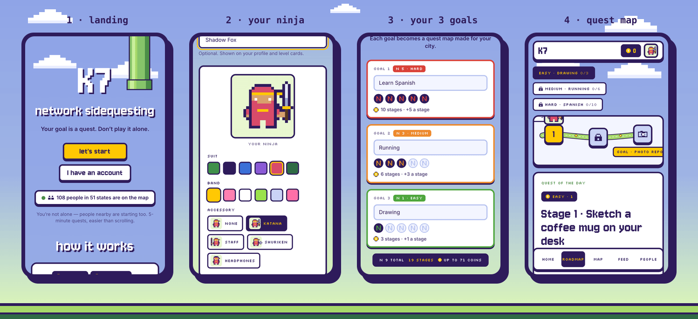
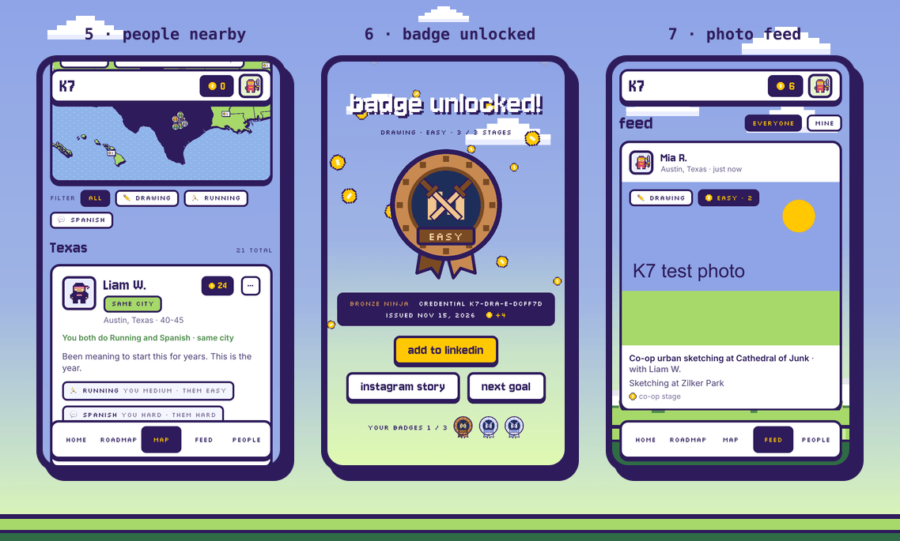
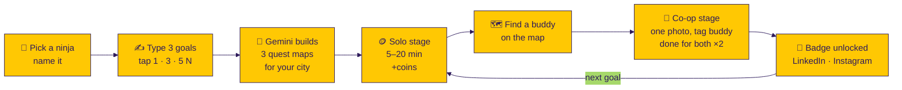
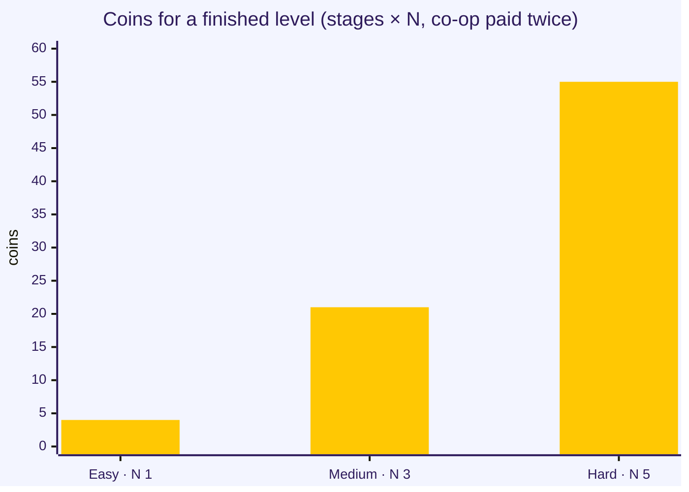
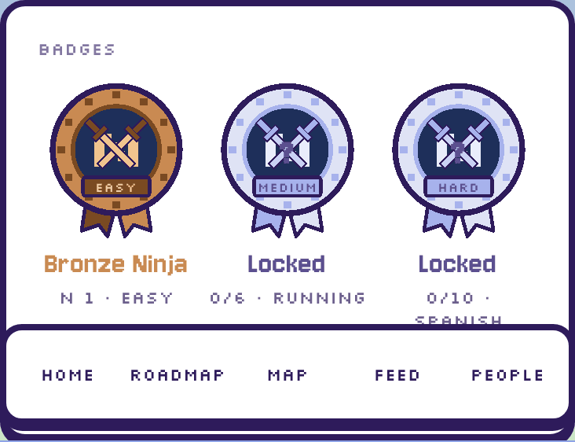
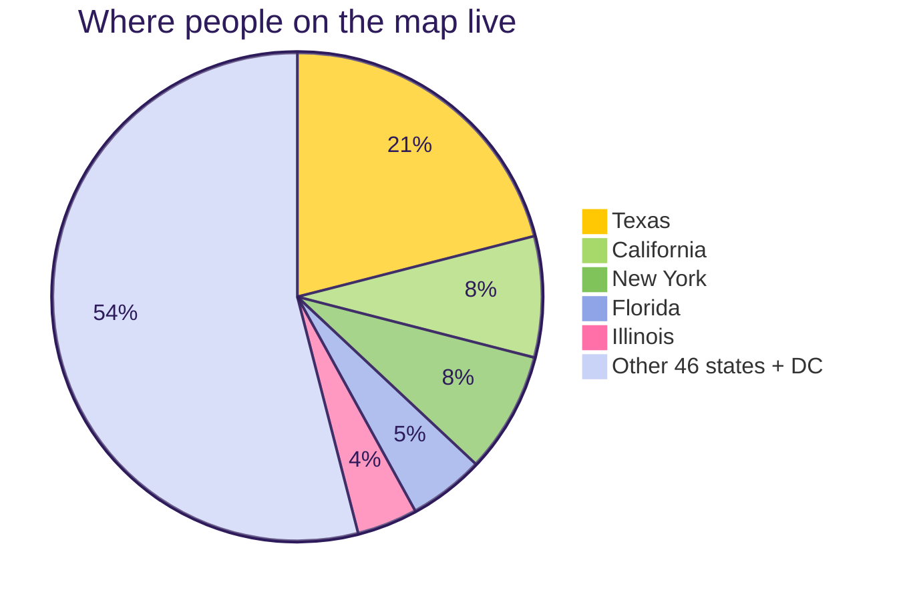
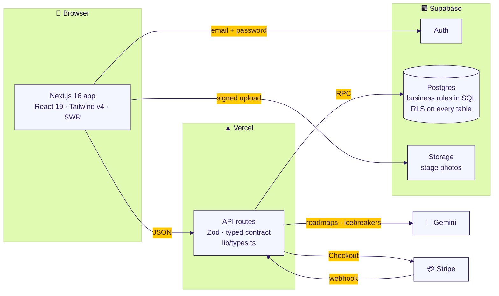

<div align="center">



# K7 — your goal is a quest

**Pick 3 goals. Get a quest map made for your city. Meet people nearby who start the same thing.**

[**▶ Open the live app**](https://k7-indol.vercel.app) · built for Business Cup 2.0 · Next.js 16 · Supabase · Stripe · Gemini

</div>

---

## 🎬 Demo video

<a href="docs/readme/demo.mp4"></a>

**[▶ Watch the demo (MP4)](docs/readme/demo.mp4)**: a full run from naming your ninja to a co-op stage and a badge.

## 🪙 What it is

Most people quit a new goal in the first two weeks because they do it alone. K7 turns any goal into a short
**quest** (5–20 minute stages, coins for every step) and puts real people next to you on a **map of the US** who are
starting the same kind of thing. Together you unlock **co-op stages**: meet up, post one photo, tag your buddy, and
both of you level up.

| | |
| --- | --- |
| **Who it's for** | Adults 25–45 in the US who keep promising themselves "this year I'll start…" |
| **What they get** | A personal roadmap per goal, a buddy nearby, small daily wins, badges worth sharing |
| **What we sell** | Depth: everyone on the map, harder levels, AI step-by-step plans, AI icebreakers |
| **Why it spreads** | Every co-op stage needs a second person, and every badge is made to be posted |

## 📱 The app




## 🗺️ How a quest works



Every goal is a level. The **N value** you give it sets its size and its reward:



| Level | N | Stages | Shape | Badge |
| --- | --- | --- | --- | --- |
| Easy | 1 | 3 | solo → find a buddy → co-op | 🥉 Bronze Ninja |
| Medium | 3 | 6 | solo ×3 → buddy → solo → co-op | 🥈 Silver Ninja |
| Hard | 5 | 10 | solo ×4 → buddy → solo ×4 → co-op | 🥇 Gold Ninja |

A photo on any stage adds +2 coins.

## 🏅 Badges you can post



Finish a level → **badge unlocked!** with a stable credential id (`K7-DRA-E-FB4736`).
**Add to LinkedIn** opens LinkedIn's "Add licence or certification" form already filled in;
**Instagram story** makes a transparent 1080×1920 PNG and opens the phone's share sheet.

## 👥 The map and buddies

- **Everyone on the map**: people who share a goal with you and live in your city come first ("You both do Running · same city").
- **City only — never your exact location.** Your social link opens only after both of you accept.
- **Type any goal you want.** "Read books" becomes Reading, "jogging" becomes Running, so people still match.
- **Co-op works like tagging on social:** one photo, tag your buddy, the stage closes for both of you at once.
- **Safety built in:** report and block from any card, meetups only in public places, pixel ninja avatars instead of faces.

## 💳 Plans

Free to start, because the map is only worth something when people are on it. People pay for depth.

| | Free | Starter **$5/mo** | Pro **$7/mo** | Crew **$9/mo** |
| --- | :---: | :---: | :---: | :---: |
| People on the map | 10 | everyone | everyone | everyone |
| Connect requests | 3 / month | unlimited | unlimited | unlimited |
| Easy level | ✅ | ✅ | ✅ | ✅ |
| Medium level | 🔒 | ✅ | ✅ | ✅ |
| Hard level | 🔒 | 🔒 | ✅ | ✅ |
| AI step-by-step plan | — | — | ✅ | ✅ |
| AI icebreakers for buddies | — | — | ✅ | ✅ |

Payments run on **Stripe Checkout** (test mode: card `4242 4242 4242 4242`). The plan is set by the webhook and again
on the success page, so it is right even if the webhook is late. Any locked tap opens a paywall that names the value:
*"Unlock Medium: Spanish — Starter $5/mo"*, *"13 more people in Texas"*.

## 🧪 Try it in 2 minutes

1. Open **https://k7-indol.vercel.app** on your phone.
2. Sign in as `judge1@example.com` or `judge2@example.com` (password on the slide), or sign up with any email.
3. Finish **Easy stage 1** → open the **map** → **connect** with someone in Texas (demo people accept at once).
4. Open the **co-op stage**, add a photo, **tag your buddy** → *badge unlocked!*
5. Tap a **Medium** stage → paywall → Stripe Checkout with `4242 4242 4242 4242` → the level opens.

The demo world is **100 demo people in all 50 states + DC**, in real cities, so the map is alive from the first minute.



## 🏗️ How it's built



- **All rules live in SQL functions** (onboarding, stage completion, co-op tagging, coins ledger, connections, blocks,
  matching), each one atomic. The API is a thin, typed layer; the browser never touches tables directly.
- **Photos never pass through the API:** compressed to 1600 px and stripped of GPS in the browser, then uploaded with a
  signed URL.
- **AI with a safety net:** one Gemini call builds all three roadmaps (~6 s) and writes icebreakers; if the model is
  slow or off, hand-written templates take over, so onboarding never fails.

## ✅ Quality

| Check | What it covers | Result |
| --- | --- | --- |
| `pnpm test:unit` | formats, plans, AI parsing, goal synonyms, credentials | 79 passing |
| `pnpm test:db` | every SQL rule, plus 12 pairs tagging each other at the same instant | all scenarios + race passing |
| `pnpm test:api` | every route against a real Supabase project | 31 passing |
| `pnpm test:e2e` | the whole golden path on iPhone 14 and Pixel 7 | 7 / 7 on both |
| `pnpm smoke` | production health, judge accounts, map, feed | passing |

## 🛠️ Run it locally

```bash
pnpm install
cp .env.example .env.local        # Supabase, Stripe, Gemini keys
bash scripts/db-push.sh --apply   # migrations → your Supabase project
pnpm seed && pnpm seed:crowd      # demo world: 100 people in every state
pnpm dev                          # http://localhost:3000
```

| Command | What |
| --- | --- |
| `pnpm verify` | typecheck + lint + unit tests + DB tests + build |
| `pnpm test:api` / `pnpm test:e2e` | API specs / golden path in the browser (need `.env.local`) |
| `pnpm seed:judges` | reset only the judge and demo accounts |
| `SMOKE_URL=https://… pnpm smoke` | production smoke test |

More detail: [`docs/BACKEND.md`](docs/BACKEND.md) (data model, rules, API) ·
[`docs/FRONTEND.md`](docs/FRONTEND.md) (screens, flows) · [`docs/TZ.md`](docs/TZ.md) (product).

<div align="center">

**K7** · made for Business Cup 2.0 · no streaks to lose, just the next stage 🥷

</div>
